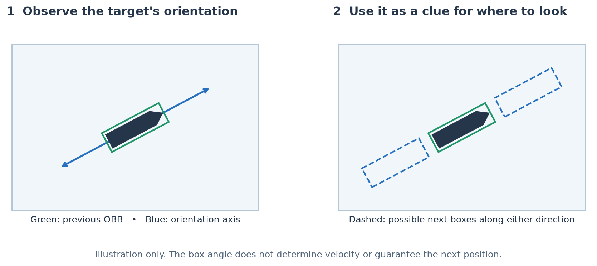
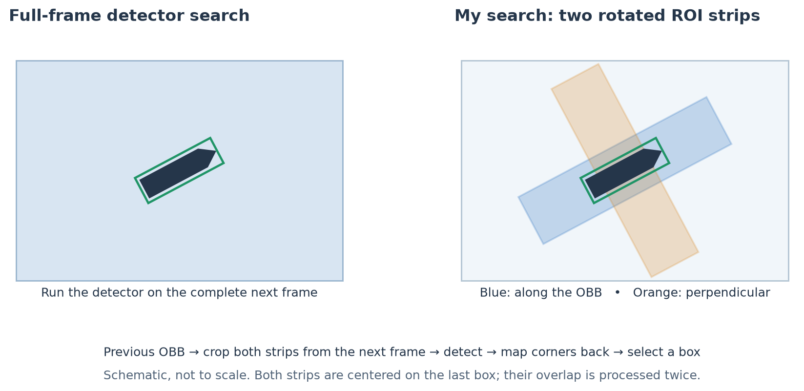
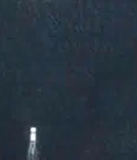
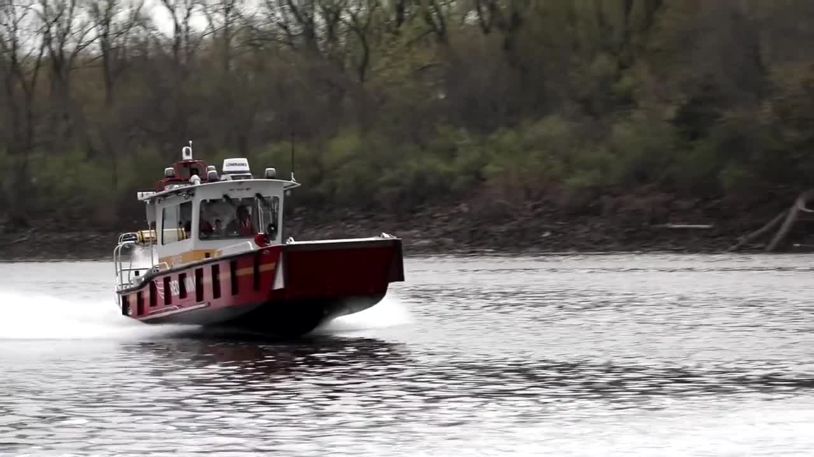
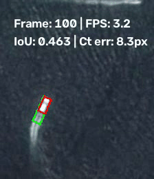
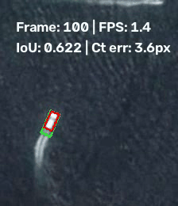
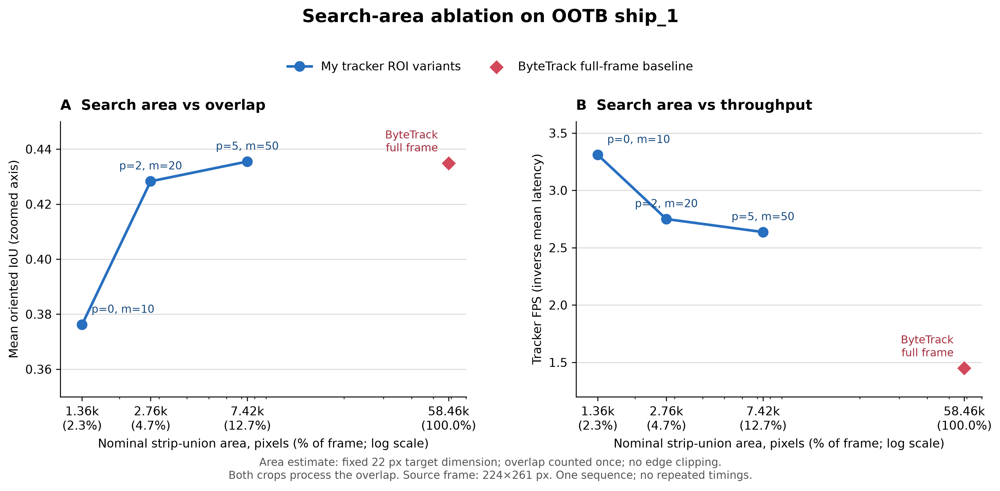

# Faster Object Tracking with Orientation-Guided Search

## Motivation

Detector-based trackers often search the entire frame to locate an object and output its bounding box. Searching the whole frame does not use the object's orientation to narrow the search. Objects often move in directions aligned with their posture. For example, a ship may move along its long axis. Information about object's movement can help to predict its possible next frame location, thus narrowing the search space.

With this in mind, I used YOLO26's oriented bounding box (OBB), provided by [detector.py](detector.py), as an estimate of the object's orientation and restricted the search region to two image strips: one along that orientation and one perpendicular to it. These strips cover potential locations of the object in the next frame. This approach can improve tracking efficiency, which matters for real-time detection. The strip generation and frame-by-frame tracking logic are implemented in [mytracker.py](mytracker.py).

## Problem Encountered and Solutions

**Initial setup:**

- YOLO26n-OBB (2.4 million parameters) as the backbone detector. It outputs oriented bounding boxes that provide information about object orientation.
- The GOT-10k evaluation set as the evaluation dataset.
- A custom region-of-interest (ROI) search function that restricts the search area to two image strips.

**Problem:**

The tracker failed to track the object.

**Solution:**

1. Larger model: I changed the backbone detector to the larger YOLO26x-OBB (57.6 million parameters). This did not resolve the problem.
2. Alternative model: The alternative detector in [detector2_fasterrcnn.py](detector2_fasterrcnn.py) uses Faster R-CNN and outputs axis-aligned bounding boxes. This did not resolve the problem.
2. Tracking consistency: I added constraints that reject detections whose center moves more than `max_move` along either image coordinate, or whose width or height is less than half or more than twice that of the previous box. This did not resolve the problem either.
3. Change dataset: I discovered that YOLO26-OBB is pretrained on overhead images of objects, which look considerably different from the GOT-10k examples I was using. I evaluated the model on OOTB, whose imagery is more similar to the pretraining data. This worked!

| OOTB `ship_1`: overhead view | GOT-10k example: `ship`|
| --- | --- |
|  |  |

## Tracker Display

| My ROI tracker | Full-frame YOLO26x-OBB + ByteTrack Baseline|
| --- | --- |
|  |  |
| [Full video](records/mytracker_ship_1.mp4) · [Per-frame CSV](records/mytracker_ship_1.csv) | [Full video](records/baseline_bytetrack_ship_1.mp4) · [Per-frame CSV](records/baseline_bytetrack_ship_1.csv) |

*(Note: red is the ground-truth bounding box, while green is the predicted bounding box. `Ct err` is short for center error.)*

## Ablation and Findings

Using the same YOLO26x-OBB detector, I created a full-frame ByteTrack baseline in [tracker_baseline.py](tracker_baseline.py) to compare with my custom motion-guided search mechanism. I also adjusted the parameters that control the strips' size: `max_move` (`m`) extends their length, while `padding` (`p`) increases their width and length. The metrics used to evaluate the tracker are FPS (speed), IoU (intersection over union), and center error.

**Findings:**

- The `(p, m) = (2, 20)` setting runs at almost twice the baseline's FPS while achieving nearly the same overlap accuracy (IoU). This suggests that motion-guided search can reduce unnecessary searching and improve efficiency while preserving similar overlap accuracy.

- As the strip area increases, overlap accuracy improves, but tracking slows down. This tradeoff is reasonable and makes intuitive sense.

The images used in this evaluation are quite small: 224 × 261 pixels. For larger images, the efficiency gain of my tracker over the baseline could be even greater, suggesting potential for object detection tasks with larger frames.

[See the full ablation data table](Ablation_data.xlsx)

## Limitation and Future Work

- The main limitation is that this mechanism may only work for certain datasets and types of motion that stay within the two search strips.

- However, the feasibility of incorporating motion-based inductive biases opens up opportunities for further exploration, including:
  - object occlusion;
  - more complex motion prediction using keypoint detection and modeling.

- I also see a potential way to pretrain a world model: give an agent a frame and train it to predict the object's next location from its posture, using the object's location in the next frame as ground truth. This could act as a form of pretraining that helps world models learn how objects move. The training data could also include more complex movements, such as those of animals and humans.
